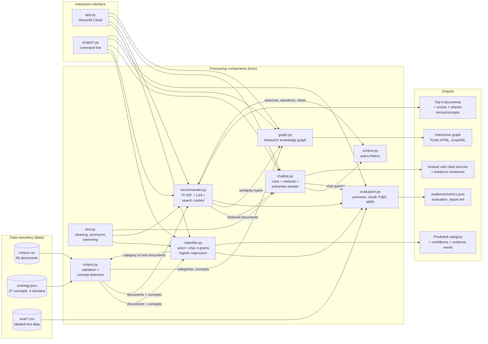

# System architecture

The system is one Python package (`kms/`) with one component per module, a Streamlit interface
(`app.py`) that exposes every component, and command-line scripts (`scripts/`) that run each
component on its own. Every component reads from the same document repository, and their outputs
feed each other while the system runs.

## Components

| Module | Role | Main technique | Output |
|---|---|---|---|
| `kms/text.py` | Shared preprocessing | Lowercasing, accent removal, synonym normalization (`log in` → `signin`, `virus` → `malware`), stopwords, light stemming | Clean text |
| `kms/corpus.py` | Repository access | CSV validation (missing file, columns, empty or duplicated IDs); keyword lexicon of the ontology | `Document` objects with their concepts |
| `kms/classifier.py` | Automated classification | TF-IDF of word 1–2 grams + character 2–4 grams, logistic regression | Category, probability per class, words that support the prediction |
| `kms/recommender.py` | Recommendations and retrieval | Cosine similarity of TF-IDF vectors (lexical) and of LSA embeddings, a 40-dimension TruncatedSVD (semantic), combined with the search context | Ranked documents with lexical, semantic, and context scores, shared terms, and shared concepts |
| `kms/context.py` | Search context | Last 10 interactions (searches, chatbot questions, opened documents), weight 0.6^age | History used by the recommender |
| `kms/chatbot.py` | Natural language queries | Intent rules, follow-up detection, retrieval of the top-3 documents, sentence ranking | Answer built from document sentences, with source IDs |
| `kms/graph.py` | Knowledge graph | NetworkX graph from the ontology, the categories, the detected concepts, and the recommender similarities; PyVis rendering | Interactive HTML graph, GraphML |
| `kms/system.py` | Integration | `KnowledgeSystem` builds every component from the same repository and rebuilds them when a document is added | One object used by the app and the scripts |
| `kms/evaluation.py` | Evaluation | Stratified 5-fold cross-validation, precision@5, recall@5, MRR, test cases | `evidence/metrics.json` |

## Information flows at run time

1. **Repository → every component.** `KnowledgeSystem` loads `corpus.csv` and `ontology.json` once,
   detects the concepts of each document, trains the classifier, and fits the recommender. The graph
   is then built from those results.
2. **Classifier → repository → recommender, chatbot, and graph.** In the *Classify* tab, a new document
   gets its category from the classifier. If the user adds it, it joins the repository and every index
   is rebuilt. The new document can then be found by search and by the chatbot, and it appears in the graph.
3. **Recommender → chatbot.** The chatbot does not keep its own index. It retrieves documents with the
   recommender's hybrid search and builds its answer from their sentences.
4. **Search context ↔ recommender.** Searches, chatbot questions, and opened documents are stored in
   the session context. The context personalizes the related documents and the *Recommended for you*
   panel.
5. **Recommender → graph.** The `similar_to` and `governed_by` edges come from the recommender's
   similarity matrix. The documents of the last search or answer are highlighted in the graph.

## Design decisions

- **The classifier uses different features from the recommender.** Categories describe the *type* of
  document, which shows in the writing style ("you", "must", "it was agreed"). Topics, which the
  recommender needs, show in the content words. Using the recommender's cleaning (stopwords removed)
  gave 42% macro recall; keeping the style words gave 88%.
- **LSA instead of a downloaded transformer model.** LSA captures latent topics. It trains in
  milliseconds on the repository itself and needs no model download or GPU, so the free tier of
  Streamlit Cloud starts quickly. A pretrained `sentence-transformers` model is the next step
  (see the recommendations in the README).
- **Extractive chatbot.** Answers are copied from repository sentences and always cite their source.
  The chatbot never invents content. When the best retrieval score is below 0.08, it says it found
  no answer.
- **Inline graph library.** vis-network is embedded in the HTML, so the graph also works offline and
  behind firewalls.
